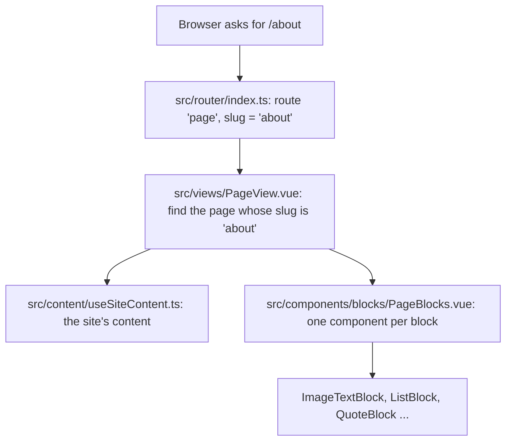
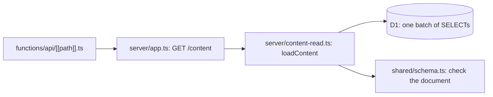
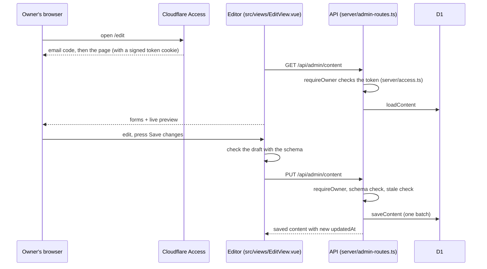

# Guide

How the site works, in plain words. Read the flow first, then use the
glossary and "where to change things" as a reference.

## The flow: a visitor opens /about

1. **Router** (`src/router/index.ts`): every address that looks like a page
   (`/`, `/about`, `/my-new-page`) goes to `PageView` with its `slug`
   (`''` for the front page).
2. **Find the page** (`src/views/PageView.vue`): looks through
   `content.pages` for that slug. No match shows the not-found page. A page
   that doesn't start with a big banner gets its title as the `h1`.
3. **The content** (`src/content/useSiteContent.ts: loadSiteContent`): at
   start-up (`src/main.ts`) the site asks the API for the whole site in one
   request, `GET /api/content`. Until it arrives, `App.vue` shows "Loading…";
   if the site has no content yet or the API fails, it says so instead.
   Every page then shares that one document (`useSiteContent`).
4. **Stack the blocks** (`src/components/blocks/PageBlocks.vue`): for each
   block, picks the component for its `type` and passes it the block (and,
   for books, news, contact and press kit, the content they show).
5. **Each block draws itself**, for example
   `src/components/blocks/ImageTextBlock.vue` puts the picture beside the
   text. Books come from `src/components/books/BookList.vue`, which groups a
   series in reading order (`src/content/format.ts: groupBooksBySeries`).

### Behind GET /api/content

1. Cloudflare Pages runs `functions/api/[[path]].ts` for every `/api/…`
   address; it hands the request to the Hono app (`server/app.ts`).
2. `loadContent` (`server/content-read.ts`) reads every table in one D1
   batch and rebuilds the document: author, theme, books with their buy
   links and reviews, news, and pages with their blocks.
3. It checks the result against the schema, so a bad row becomes a plain
   "something went wrong" (500) rather than a broken page.
4. The answer may be cached for 60 seconds, so a saved change can take a
   minute to show.

Saving (`server/content-write.ts: saveContent`) is the reverse: it refuses a
save made from an older copy (so a forgotten tab can't undo newer work),
then deletes every content row and inserts the new ones in **one D1
batch**, which D1 runs as one transaction.

## The second flow: the owner edits and saves

1. **Sign-in** happens before our code runs: Cloudflare Access asks for the
   owner's email, sends a one-time code, and only then lets `/edit` and
   `/api/admin/*` through, adding a signed token to each request.
2. **The guard** (`server/access.ts: requireOwner`) checks that token again
   with `jose`. With no Access settings it refuses (503), so a forgotten
   Access policy can't leave the editor open.
3. **Loading** (`src/editor/useEditor.ts: createEditor` →
   `src/editor/editorApi.ts: fetchDraft`): the saved site becomes the
   draft. A brand-new site starts from the example content.
4. **Editing**: the tabs (`src/editor/tabs/`) change the draft directly;
   each block type has its form (`src/editor/block-forms/`). The draft is
   shared through `provide`/`inject` (`useDraft`).
5. **Preview** (`src/editor/SitePreview.vue`): the same components as the
   public site draw the draft, in the draft's colours and fonts.
6. **Saving** (`createEditor: save`): the draft is checked with the schema
   first, so mistakes are listed right away, each with where it is
   (`src/editor/problems.ts`). Then `sendDraft` sends it; the API checks
   it again, refuses a save from an older copy (409), and writes it.

### Pictures

1. In a picture field (`src/editor/fields/ImageField.vue`) the owner picks
   a file. The editor checks its type and size first (`shared/images.ts`).
2. `uploadImage` (`src/editor/editorApi.ts`) sends it to
   `POST /api/admin/images` (`server/image-routes.ts`), behind the same
   sign-in check. The API checks again, including the file's first bytes,
   and stores it in R2 as `images/<random id>.<jpg|png|webp>`.
3. The returned key goes into the draft (a cover, a photo, a banner); the
   preview shows it straight away. It goes live when the owner saves.
4. Visitors load it from `GET /api/images/<id>.png`, cached for a year (a
   key is never reused, so the picture behind it never changes).

A picture uploaded but never saved stays in R2 unused. At this size that's
harmless.

### Colours, fonts and the menu

The site's colours and fonts come from `content.theme`:
`src/composables/useSiteTheme.ts` turns them into CSS variables
(`src/content/themeVariables.ts`) on the page and loads the chosen fonts
(`src/styles/fonts.ts`). Every style uses those variables, so changing the
theme restyles the whole site at once.

The menu (`src/components/layout/SiteHeader.vue`) lists the pages whose
`showInMenu` is on, in the order of `content.pages`.

## Glossary

- **Block**: one piece of a page, like a banner or a list. Its fields and
  error messages are in `shared/blocks.ts`.
- **Page**: a title, an address (slug) and a stack of blocks
  (`shared/schema.ts: pageSchema`).
- **Slug**: the part of the address after the `/`. The front page's is
  empty. `edit` and `api` are kept for the site itself.
- **Content document**: everything on the site as one object
  (`SiteContent`): author, theme, books, news, pages and `updatedAt`.
- **Zod schema**: a description of the content's shape that can also check
  it. The same schema checks the editor's draft and the API's input, and
  its messages are what the owner sees.
- **Theme**: the owner's background, text, accent, button colours and
  heading and body fonts (`shared/theme.ts`). A banner block can also have
  its own colours.
- **CSS variable**: a named value like `--color-accent` that the styles
  read; setting it once changes every place that uses it.
- **Contrast ratio**: how readable text is on its background, from 1 to 21.
  4.5 or more is readable (`shared/theme.ts: contrastRatio`).
- **Typeset cover**: the plain title-on-colour cover shown until a book has
  a cover image (`src/components/books/BookCover.vue`).
- **D1**: Cloudflare's SQLite database. The tables are in
  `migrations/0001_create_content_tables.sql`.
- **Binding**: how the API reaches a Cloudflare resource, like `env.DB` for
  the database. Named in `wrangler.toml` and typed in `server/env.ts`.
- **Pages Function**: code Cloudflare Pages runs on the server for some
  addresses (here `/api/*`); it is a Cloudflare Worker.
- **Hono**: the small web framework that routes API requests
  (`server/app.ts`).
- **Batch**: several SQL statements sent to D1 together; D1 runs a batch as
  one transaction (all or nothing).
- **Miniflare**: Cloudflare's local simulator; the API tests use it for a
  real local D1 (`tests/api/test-database.ts`).
- **Cloudflare Access**: Cloudflare's sign-in gate. It sits in front of
  `/edit` and `/api/admin/*` and lets in only the emails on its list, using
  a one-time code sent by email.
- **Access token (JWT)**: a signed note Access adds to each request
  (`Cf-Access-Jwt-Assertion`) saying who signed in. `server/access.ts`
  checks its signature, issuer, audience and expiry.
- **Fail closed**: when something is missing or wrong, refuse rather than
  allow. The editor's API refuses all saves if Access isn't configured.
- **Draft**: the editor's working copy of the content; nothing changes on
  the site until it is saved.
- **Stale save**: a save made from an older copy than the one stored; the
  API refuses it (409) so it can't undo newer changes.
- **R2**: Cloudflare's file storage, here for pictures. The bucket is
  private; pictures are served through the API.
- **Magic bytes**: the first bytes every file of a type starts with (a PNG
  starts `89 50 4E 47`). The API checks them so a renamed file is refused.
- **Image key**: the name an uploaded image is stored under, like
  `images/<id>.jpg`; the site loads it from `/api/images/<id>.jpg`
  (`src/content/format.ts: imageUrl`).

## Where to change things

- **Add a block type:** add its schema to `shared/blocks.ts` (and to
  `blockSchema` and `BLOCK_NAMES`), add a component in
  `src/components/blocks/` and a line for it in `PageBlocks.vue`, add a
  form in `src/editor/block-forms/` and a line in `BlockForm.vue`, and give
  it starting values in `src/editor/newItems.ts` and a description in
  `src/editor/tabs/AddBlockPicker.vue`.
- **Change the default colours or fonts:** `DEFAULT_THEME` in
  `shared/theme.ts`, and the same values in `src/styles/theme.css` (shown
  before the content loads).
- **Offer another font:** install its `@fontsource-variable/…` package, add
  it to `FONTS` in `shared/theme.ts` and to `FONT_LOADERS` in
  `src/styles/fonts.ts`.
- **Change a field's rules or its error message:** `shared/fields.ts` or the
  schema that uses it.
- **Change the demo content:** `shared/demo-content.ts`.
- **Change a label or hint in the editor:** the form components in
  `src/editor/tabs/` and `src/editor/block-forms/`.
- **Change an error message the owner sees:** field rules in
  `shared/fields.ts` and the schemas; server messages in
  `server/admin-routes.ts` and `server/access.ts`; connection messages in
  `src/editor/editorApi.ts`.
- **Add an API address:** a route in `server/app.ts`, with a test in
  `tests/api/`.
- **Add a field to a block:** give it a `.default(…)` in
  `shared/blocks.ts`. Blocks are stored as JSON, so sites saved before the
  field existed don't have it; without a default they would fail to load.
- **Deploy or change the Cloudflare setup:** the checklist at the end of
  the README; bindings live in `wrangler.toml`, security headers in
  `public/_headers`.
- **Change the database tables:** add a new numbered file in `migrations/`
  (never edit one that has been applied), then update
  `server/content-read.ts` and `server/content-write.ts`.
