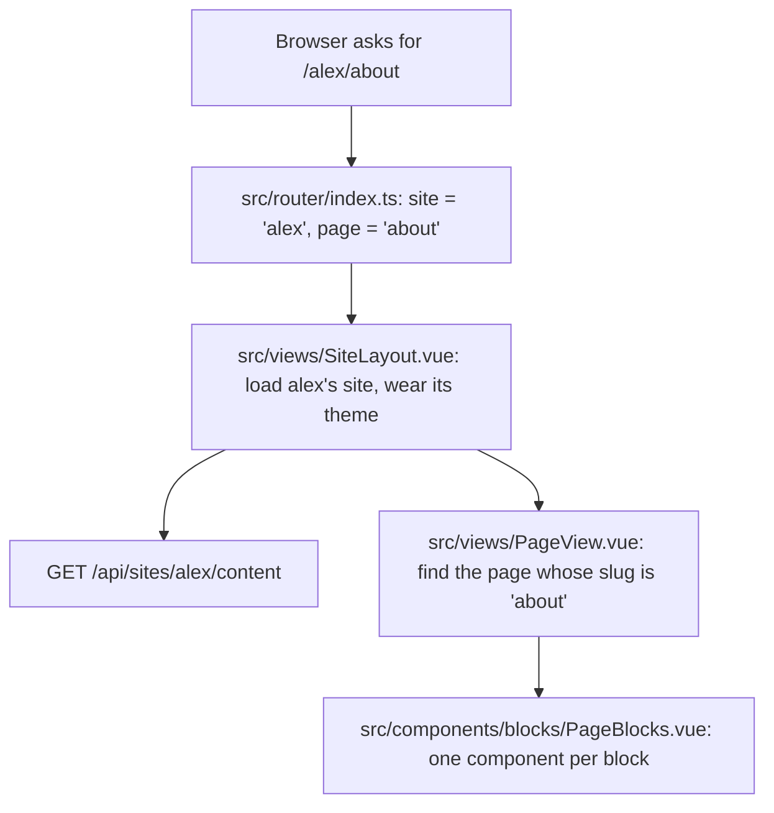
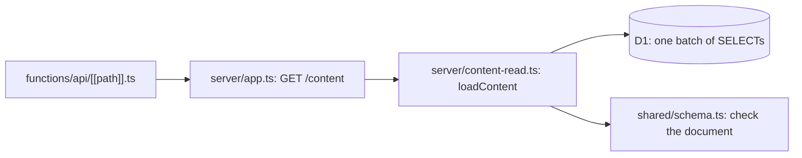
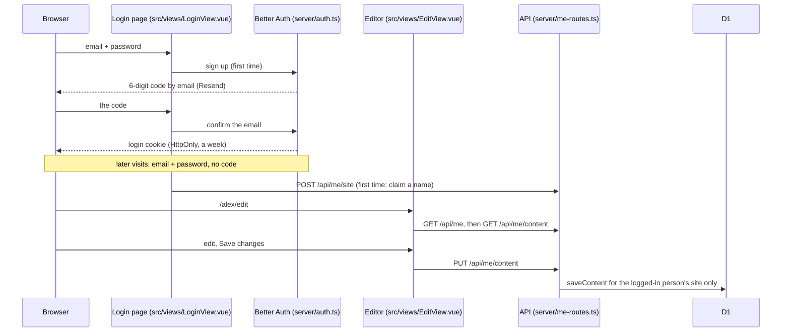

# Guide

How Framed works, in plain words. Framed gives anyone a portfolio page
they build from blocks, at `framed.my.id/<name>`. Read the flows first,
then use the glossary and "where to change things" as a reference.

## The flow: a visitor opens /alex/about

1. **Router** (`src/router/index.ts`): fixed pages (`/`, `/login`, `/terms`,
   `/privacy`) come first. Anything else is `/<site>`, `/<site>/<page>`,
   `/<site>/work/<work>` (a work's own page, `src/views/WorkPageView.vue`)
   or `/<site>/edit`.
2. **The site** (`src/views/SiteLayout.vue`): asks the API for that site's
   whole content in one request (`src/content/useSiteContent.ts:
   loadSiteContent`). Until it arrives it shows "Loading…"; for a name
   nobody has, an unsaved site or a failure, it says so. It puts the site's
   theme on its own box (`src/content/themeVariables.ts`) and tells the
   components the site's name, so their links (`/work`) become
   `/alex/work` (`src/content/sitePath.ts`).
3. **Find the page** (`src/views/PageView.vue`): looks through
   `content.pages` for the slug (`''` for the front page). No match shows
   the not-found page.
4. **Stack the blocks** (`src/components/blocks/PageBlocks.vue`): for each
   block, picks the component for its `type` and passes it the block (and,
   for work, news, contact and press kit, the content they show).
5. **Each block draws itself**, for example
   `src/components/blocks/ImageTextBlock.vue` puts the picture beside the
   text. Work comes from `src/components/works/WorkList.vue`, in exactly the
   order the owner arranged it; neighbouring works of one group share a
   heading (`src/content/format.ts: groupAdjacentSeries`). In the editor the
   owner drags them into order (`vue-draggable-plus`) or uses Up and Down.

### Behind GET /api/sites/&lt;name&gt;/content

1. Cloudflare Pages runs `functions/api/[[path]].ts` for every `/api/…`
   address; it hands the request to the Hono app (`server/app.ts`).
2. The route finds the site by name (`server/sites.ts`); a hidden site
   answers 404. `loadContent` (`server/content-read.ts`) reads every table
   in one D1 batch, only that site's rows (each row carries `site_id`), and rebuilds the document: profile, theme, works with their
   links and quotes, news, and pages with their blocks.
3. It checks the result against the schema, so a bad row becomes a plain
   "something went wrong" (500) rather than a broken page.
4. The answer may be cached for 60 seconds, so a saved change can take a
   minute to show.

Saving (`server/content-write.ts: saveContent`) is the reverse: it refuses a
save made from an older copy (so a forgotten tab can't undo newer work),
then deletes every content row and inserts the new ones in **one D1
batch**, which D1 runs as one transaction.

## The second flow: someone logs in, edits and saves

1. **Login** (`src/auth/useLogin.ts`, `src/auth/authClient.ts`): a new
   person signs up with an email and a password (at least 10 characters,
   `shared/passwords.ts`), then types the 6-digit code we email to confirm
   the address; after that they log in with the password. "Forgot your
   password?" emails a code that sets a new one and logs out every device.
   Passwords are hashed with PBKDF2 (`server/password-hash.ts`), and ones
   found in data breaches are refused (Better Auth's `haveIBeenPwned`).
   Codes are stored hashed, expire after 10 minutes and allow 5 tries;
   logging in and asking for codes are rate-limited (`server/auth.ts`).
   Locally the codes are printed in the terminal (`server/email.ts`).
2. **A name** (first time only): `POST /api/me/site` claims
   `framed.my.id/<name>` (`server/sites.ts: createSite`); the rules are in
   `shared/names.ts`, checked in the form and again by the API.
3. **Whose site** (`server/session.ts`): every `/api/me/…` route first
   checks the login cookie (`requireUser`), then finds that person's own
   site (`requireSite`). The site never comes from the request, so nobody
   can write to someone else's. Writes must also come from Framed's own
   pages (`csrf()` checks the Origin header).
4. **Edit mode**: the app knows who is logged in on every page
   (`src/auth/useAccount.ts`). On their own page the owner sees a small bar
   (`src/components/layout/OwnerBar.vue`): "Edit this page" opens the
   editor on that page (`/<name>/edit?page=work`), and the editor's "Done"
   goes back, asking first if anything is unsaved. Edit mode only changes
   what the screen shows; the server checks the login on every save.
5. **Loading** (`src/editor/useEditor.ts: createEditor` →
   `src/editor/editorApi.ts: fetchDraft`): the editor asks who is logged in;
   on someone else's page it says so and links to theirs. A new site starts
   from the example content.
6. **Editing**: the tabs (`src/editor/tabs/`) change the draft directly;
   each block type has its form (`src/editor/block-forms/`). The draft is
   shared through `provide`/`inject` (`useDraft`).
7. **Preview** (`src/editor/SitePreview.vue`): the same components as the
   public site draw the draft, in the draft's colours and fonts. Clicking a
   block there selects it (`src/editor/blockSelection.ts`): the Pages tab
   opens and scrolls to that block's form. Working in a form outlines its
   block in the preview. **Undo** and **Redo** in the top bar step through
   the edits (`src/editor/undoHistory.ts`); a short pause in editing closes
   one step.
8. **Saving** (`saveDraft`): checked with the schema first, so mistakes are
   listed right away with where they are (`src/editor/problems.ts`); the API
   checks again, refuses a save from an older copy (409), writes it, and
   tidies pictures the site no longer uses (`server/image-limits.ts`).
9. **Unsaved changes are kept** in the browser (`src/editor/draftBackup.ts`,
   one backup per site), so an expired login or a closed tab loses nothing.
10. **Deleting an account** (`server/account-deletion.ts`) removes the
   person's pictures, site, logins and account at once.

### Pictures

1. In a picture field (`src/editor/fields/ImageField.vue`) the owner picks
   a file. The editor checks its type and size first (`shared/images.ts`).
2. `uploadImage` (`src/editor/editorApi.ts`) sends it to
   `POST /api/me/images` (`server/image-routes.ts`), behind the same login
   check. The API checks again, including the file's first bytes, checks
   the site's allowance (200 pictures, 200 MB), stores it in R2 as
   `images/<random id>.<jpg|png|webp>` and records it in the `images`
   table.
3. The returned key goes into the draft (a picture of work, a photo, a banner); the
   preview shows it straight away. It goes live when the owner saves.
4. Visitors load it from `GET /api/images/<id>.png`, cached for a year (a
   key is never reused, so the picture behind it never changes).

**Cropping.** A picture is never cut. Each use of it keeps a crop: a focus
point (x and y, in percent) and a zoom (`shared/fields.ts: imageCrop`).
`src/components/ui/FramedImage.vue` fills its frame with the picture,
keeping the focus point in view and zooming around it. In the editor,
`src/editor/fields/ImageCropper.vue` shows the same picture in a frame of
the same shape (`src/content/frames.ts`): dragging or the arrow keys move
the focus point, a slider sets the zoom. Because only these three numbers
are stored, one crop fits a frame of any size (the banner changes shape
with the screen), and the press kit still offers the whole original.

A picture uploaded but never used is deleted after a later save, once it
is a day old (`server/image-limits.ts: pruneUnusedImages`).

### Colours, fonts and the menu

The site's colours and fonts come from `content.theme`:
`src/composables/useSiteTheme.ts` turns them into CSS variables
(`src/content/themeVariables.ts`) on the page and loads the chosen fonts
(`src/styles/fonts.ts`). Every style uses those variables, so changing the
theme restyles the whole site at once. The background is part of the theme
too: a pattern drawn in CSS from the text colour, or a picture with a light
panel over it (`src/content/backgroundStyle.ts`, the `site-background` and
`site-panel` utilities in `src/styles/theme.css`).

The site's layout follows the width of its container, not of the window:
the components use Tailwind's container variants (`@2xl:`, `@3xl:`), and
the page and the editor's preview are each a container (`@container`). So
when the owner drags the divider in the editor (`src/views/EditView.vue`,
with `splitpanes`), a narrow preview shows the phone layout.

The menu (`src/components/layout/SiteHeader.vue`) lists the pages whose
`showInMenu` is on, in the order of `content.pages`.

## Glossary

- **Block**: one piece of a page, like a banner or a list. Its fields and
  error messages are in `shared/blocks.ts`.
- **Page**: a title, an address (slug) and a stack of blocks
  (`shared/schema.ts: pageSchema`).
- **Slug**: the part of the address after the `/`. The front page's is
  empty. `edit` and `api` are kept for the site itself.
- **Content document**: everything on the site as one object
  (`SiteContent`): profile, theme, works, news, pages and `updatedAt`.
- **Zod schema**: a description of the content's shape that can also check
  it. The same schema checks the editor's draft and the API's input, and
  its messages are what the owner sees.
- **Theme**: the owner's background, text, accent, button colours and
  heading and body fonts (`shared/theme.ts`). A banner block can also have
  its own colours.
- **CSS variable**: a named value like `--color-accent` that the styles
  read; setting it once changes every place that uses it.
- **Contrast ratio**: how readable text is on its background, from 1 to 21.
  4.5 or more is readable (`shared/theme.ts: contrastRatio`).
- **Box style**: any block's own box: fill colour, pattern, opacity (of the
  fill only; text stays solid), text colour and corners
  (`shared/theme.ts: boxStyleSchema`, `src/components/blocks/BlockBox.vue`).
  A plain style draws no box. It can also set the block's own button and
  button-text colours.
- **Picture shape and corners**: portrait, landscape, square or wide
  (`shared/theme.ts: WORK_SHAPES`), and sharp to round corners
  (`PICTURE_CORNERS`), drawn as Tailwind classes (`src/content/frames.ts`).
  Every block with a picture has both: the banner (whose shape can also
  "fit the words"), picture and text, works and the press kit. The Look
  tab's shape is the default for pictures of work.
- **Page layout (template)**: a ready-made stack of blocks with starting
  text, picked when adding a page (`src/editor/pageTemplates.ts`,
  `TemplatePicker.vue`). Only a starting point: the page isn't linked to it
  afterwards.
- **Saved layout**: a page (or a work's page) the owner saved with "Save as
  a layout"; it is offered next to the ready-made layouts
  (`src/editor/savedLayouts.ts`, `SaveAsLayout.vue`). Its blocks are copies
  with new ids, stored in the `blocks` table under the layout's id
  (`migrations/0005`), and visitors never receive them
  (`server/public-routes.ts`).
- **Gallery block**: a grid of uploaded pictures in one shape, each with a
  caption (`GalleryBlock.vue`, `GalleryForm.vue`); its pictures count as in
  use when unused ones are tidied (`server/image-limits.ts`). Clicking a
  picture opens it whole in a full-size view (`GalleryLightbox.vue`, the
  browser's own `<dialog>`), with Previous / Next, the arrow keys and Esc.
- **Work page**: every work's own page at `/<site>/work/<pageSlug>`
  (`src/components/works/WorkPage.vue`), unless "Show a page for this
  work" is off (`showPage`): its details, its more pictures as a gallery
  (`PictureGrid.vue`), then its blocks, then links to the previous and next
  work. A work and its page are edited together in the Pages tab
  (`src/editor/tabs/WorkEditor.vue`); the Work tab only orders works and
  opens them, and "+ Add a project" in the Pages tab makes a new one from
  a layout. More pictures live in `work_pictures`, page blocks in `blocks`
  under the work's id (`migrations/0004`, `0006`). Works saved before every
  work had a page get an address from their title when read
  (`server/content-read.ts: withAddresses`).
- **Picked works**: a works block set to "Only the ones I tick" shows the
  works in its `pickedWorkIds`, in the Work tab's order.
- **No colour**: a fill (the content box, part of a pattern, a banner) set
  to `transparent`, so whatever is behind shows through
  (`shared/theme.ts: NO_COLOUR`, `fillColour`). Text colours can't be
  empty this way.
- **Undo history**: copies of the draft, one per pause in editing, that
  Undo and Redo step through (`src/editor/undoHistory.ts`). It starts again
  on every load and save, so a saved version is never undone.
- **Block selection**: the block the owner is working on, shared by the
  preview and the forms (`src/editor/blockSelection.ts`). Each block's box
  carries `data-block-id`, so a click in the preview knows which block it
  hit.
- **Content box**: the panel over a background picture or a strongly
  coloured pattern; its colour, opacity, corners and width (framed or all
  the way across) are in the Look tab (`theme.panel`).
- **Background pattern**: dots, graph paper, pinstripes, argyle or linen,
  made of CSS gradients in a faint mix of the text colour, so they suit any
  colours and fonts.
- **Container query**: a style rule that depends on the width of a box on
  the page rather than the whole window (`@container`).
- **Work**: anything someone shows: a project, book, building, painting or
  app (`shared/schema.ts: workSchema`), with a picture whose shape the
  owner picks for the whole site (portrait, landscape, square, wide).
- **Typeset card**: the plain title-on-colour card shown until a work has a
  picture (`src/components/works/WorkPicture.vue`).
- **D1**: Cloudflare's SQLite database. The tables are in
  `migrations/0001_create_content_tables.sql`.
- **Binding**: how the API reaches a Cloudflare resource, like `env.DB` for
  the database. Named in `wrangler.toml` and typed in `server/env.ts`.
- **Pages Function**: code Cloudflare Pages runs on the server for some
  addresses (here `/api/*`); it is a Cloudflare Worker.
- **Hono**: the small web framework that routes API requests
  (`server/app.ts`).
- **Batch**: several SQL statements sent to D1 together; D1 runs a batch as
  one transaction (all or nothing).
- **Miniflare**: Cloudflare's local simulator; the API tests use it for a
  real local D1 (`tests/api/test-database.ts`).
- **Better Auth**: the login library (`server/auth.ts`). It runs in our own
  Worker and keeps its tables (`user`, `session`, `verification`, `account`,
  `rateLimit`) in our D1 (`migrations/0001`); password hashes live in
  `account.password`.
- **Emailed code (OTP)**: a 6-digit one-time code, emailed to confirm an
  address at sign-up or to reset a password. It can't be used to log in.
- **Password hash (PBKDF2)**: a password scrambled one way, with a random
  salt and 100,000 rounds (the most Cloudflare allows), so a stolen
  database doesn't reveal passwords (`server/password-hash.ts`). The round
  count is stored with each hash so it can be raised later.
- **Leaked-password check**: Better Auth's `haveIBeenPwned` plugin sends the
  first 5 characters of the password's SHA-1 hash to api.pwnedpasswords.com
  and refuses passwords found in breaches; the password itself never
  leaves the server.
- **Session**: a login, remembered by an HttpOnly cookie for a week; "Log
  out" ends it at once.
- **Site name**: the part of the address after `framed.my.id/`
  (`shared/names.ts`); one per person.
- **CSRF**: a hostile website making a logged-in person's browser send a
  request. `csrf()` (`server/me-routes.ts`) refuses writes whose Origin
  isn't Framed, on top of the cookie's SameSite rule.
- **Test account**: `test@framed.local`, which owns `/test` in the local
  database only (`npm run db:seed:test`, which also sets its password).
- **Fail closed**: when something is missing or wrong, refuse rather than
  allow.
- **Draft backup**: a copy of unsaved changes in the browser's
  `localStorage`, brought back after a reload or a new sign-in.
- **Draft**: the editor's working copy of the content; nothing changes on
  the site until it is saved.
- **Stale save**: a save made from an older copy than the one stored; the
  API refuses it (409) so it can't undo newer changes.
- **R2**: Cloudflare's file storage, here for pictures. The bucket is
  private; pictures are served through the API.
- **Crop (focus point and zoom)**: how a picture sits in its frame; the
  file itself is never changed.
- **Magic bytes**: the first bytes every file of a type starts with (a PNG
  starts `89 50 4E 47`). The API checks them so a renamed file is refused.
- **Image key**: the name an uploaded image is stored under, like
  `images/<id>.jpg`; the site loads it from `/api/images/<id>.jpg`
  (`src/content/format.ts: imageUrl`).

## Where to change things

- **Add a block type:** add its schema to `shared/blocks.ts` (and to
  `blockSchema` and `BLOCK_NAMES`), add a component in
  `src/components/blocks/` and a line for it in `PageBlocks.vue`, add a
  form in `src/editor/block-forms/` and a line in `BlockForm.vue`, and give
  it starting values in `src/editor/newItems.ts` and a description in
  `src/editor/tabs/AddBlockPicker.vue`.
- **Change the default colours or fonts:** `DEFAULT_THEME` in
  `shared/theme.ts`, and the same values in `src/styles/theme.css` (shown
  before the content loads).
- **Add or change a page layout:** `PAGE_TEMPLATES` (site pages) or
  `WORK_PAGE_TEMPLATES` (a work's own page) in `src/editor/pageTemplates.ts`;
  a test checks every layout makes blocks that can be saved.
- **Add a picture shape:** a name in `WORK_SHAPES` (`shared/theme.ts`) and
  its classes in `WORK_SHAPE_CLASSES`, `WORK_COLUMN_CLASSES`,
  `PICTURE_BESIDE_TEXT_CLASSES` and `BANNER_SHAPE_CLASSES`
  (`src/content/frames.ts`). Corners work the same way with
  `PICTURE_CORNERS` and `PICTURE_CORNER_CLASSES`.
- **Add a background pattern:** a name in `BACKGROUND_PATTERNS`
  (`shared/theme.ts`) and its gradients in `PATTERNS`
  (`src/content/backgroundStyle.ts`).
- **Offer another font:** install its `@fontsource-variable/…` package, add
  it to `FONTS` in `shared/theme.ts` and to `FONT_LOADERS` in
  `src/styles/fonts.ts`.
- **Change a field's rules or its error message:** `shared/fields.ts` or the
  schema that uses it.
- **Change the demo content:** `shared/demo-content.ts`.
- **Change how a selected block looks:** the outline classes
  (`BLOCK_OUTLINES`) in `src/editor/SitePreview.vue`, and the `data-selected:`
  classes in `src/editor/tabs/PageBlocksEditor.vue`.
- **Change the editor's how-tos:** `HOW_TOS` in `src/editor/tabs/HelpTab.vue`;
  update it when a button or tab is renamed.
- **Change a label or hint in the editor:** the form components in
  `src/editor/tabs/` and `src/editor/block-forms/`.
- **Change an error message people see:** field rules in
  `shared/fields.ts`, `shared/names.ts` and the schemas; server messages in
  `server/me-routes.ts`, `server/content-routes.ts`, `server/session.ts`
  and `server/image-limits.ts`; login messages in `src/auth/useLogin.ts`;
  connection messages in `src/editor/editorApi.ts`.
- **Change the login (code length, expiry, session length, rate limits):**
  the constants at the top of `server/auth.ts`; password length in
  `shared/passwords.ts`; hashing rounds in `server/password-hash.ts`.
- **Change a site's picture allowance:** `server/image-limits.ts`.
- **Reserve another address:** `RESERVED_NAMES` in `shared/names.ts`.
- **Add an API address:** a route in `server/public-routes.ts` (anyone) or
  `server/me-routes.ts` (logged in), with a test in `tests/api/`.
- **Add a field to a block:** give it a `.default(…)` in
  `shared/blocks.ts`. Blocks are stored as JSON, so sites saved before the
  field existed don't have it; without a default they would fail to load.
- **Deploy or change the Cloudflare setup:** the checklist at the end of
  the README; bindings live in `wrangler.toml`, security headers in
  `public/_headers`.
- **Change the database tables:** add a new numbered file in `migrations/`
  (never edit one that has been applied), then update
  `server/content-read.ts` and `server/content-write.ts`.
