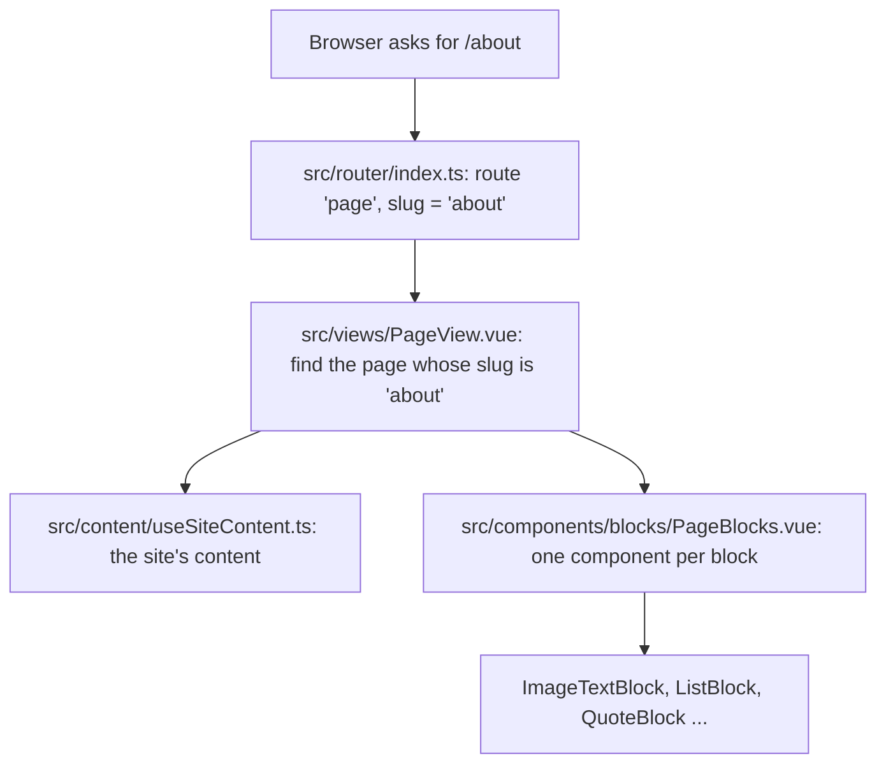

# Guide

How the site works, in plain words. Read the flow first, then use the
glossary and "where to change things" as a reference.

## The flow: a visitor opens /about

1. **Router** (`src/router/index.ts`): every address that looks like a page
   (`/`, `/about`, `/my-new-page`) goes to `PageView` with its `slug`
   (`''` for the front page).
2. **Find the page** (`src/views/PageView.vue`): looks through
   `content.pages` for that slug. No match shows the not-found page. A page
   that doesn't start with a big banner gets its title as the `h1`.
3. **The content** (`src/content/useSiteContent.ts: useSiteContent`): one
   shared document with the author, books, news and pages. For now it is the
   demo document in `shared/demo-content.ts`.
4. **Stack the blocks** (`src/components/blocks/PageBlocks.vue`): for each
   block, picks the component for its `type` and passes it the block (and,
   for books, news, contact and press kit, the content they show).
5. **Each block draws itself**, for example
   `src/components/blocks/ImageTextBlock.vue` puts the picture beside the
   text. Books come from `src/components/books/BookList.vue`, which groups a
   series in reading order (`src/content/format.ts: groupBooksBySeries`).

The site's colours and fonts come from `content.theme`:
`src/composables/useSiteTheme.ts` turns them into CSS variables
(`src/content/themeVariables.ts`) on the page and loads the chosen fonts
(`src/styles/fonts.ts`). Every style uses those variables, so changing the
theme restyles the whole site at once.

The menu (`src/components/layout/SiteHeader.vue`) lists the pages whose
`showInMenu` is on, in the order of `content.pages`.

## Glossary

- **Block**: one piece of a page, like a banner or a list. Its fields and
  error messages are in `shared/blocks.ts`.
- **Page**: a title, an address (slug) and a stack of blocks
  (`shared/schema.ts: pageSchema`).
- **Slug**: the part of the address after the `/`. The front page's is
  empty. `edit` and `api` are kept for the site itself.
- **Content document**: everything on the site as one object
  (`SiteContent`): author, books, news, pages and `updatedAt`.
- **Zod schema**: a description of the content's shape that can also check
  it. The same schema checks the editor's draft and the API's input, and
  its messages are what the owner sees.
- **Theme**: the owner's background, text, accent, button colours and
  heading and body fonts (`shared/theme.ts`). A banner block can also have
  its own colours.
- **CSS variable**: a named value like `--color-accent` that the styles
  read; setting it once changes every place that uses it.
- **Contrast ratio**: how readable text is on its background, from 1 to 21.
  4.5 or more is readable (`shared/theme.ts: contrastRatio`).
- **Typeset cover**: the plain title-on-colour cover shown until a book has
  a cover image (`src/components/books/BookCover.vue`).
- **Image key**: the name an uploaded image is stored under, like
  `images/<id>.jpg`; the site loads it from `/api/images/<key>`.

## Where to change things

- **Add a block type:** add its schema to `shared/blocks.ts` (and to
  `blockSchema` and `BLOCK_NAMES`), add a component in
  `src/components/blocks/`, and add a line for it in `PageBlocks.vue`.
- **Change the default colours or fonts:** `DEFAULT_THEME` in
  `shared/theme.ts`, and the same values in `src/styles/theme.css` (shown
  before the content loads).
- **Offer another font:** install its `@fontsource-variable/…` package, add
  it to `FONTS` in `shared/theme.ts` and to `FONT_LOADERS` in
  `src/styles/fonts.ts`.
- **Change a field's rules or its error message:** `shared/fields.ts` or the
  schema that uses it.
- **Change the demo content:** `shared/demo-content.ts`.
